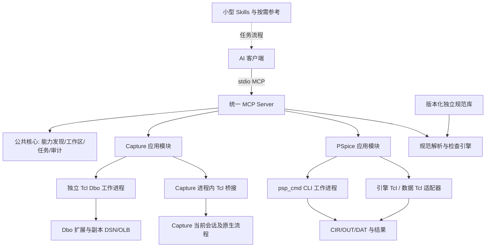

# 架构与模块边界

本文所有模块名、目录和工具均为建议设计，不是已安装能力。

## 1. 执行链



Dbo API 的真正执行者是加载了 Cadence 扩展的 Tcl 解释器。MCP 负责接收结构化操作、路由、校验与返回；Skill 引导 AI 使用这些工具；规范决定设计应满足哪些约束。四者职责分开。

PSpice 与 Capture 共享项目上下文，但引擎、许可证和生命周期不同。PSpice 可直接使用 CIR/模型文件仿真，不必经 Capture。Capture 设计进入仿真时，需要单独验证“原理图 → PSpice 网表/CIR/分析配置”的生成链；普通 Capture 网络提取或 PCB 网表不等于仿真输入。

## 2. 模块职责与接口覆盖

|模块|内部职责|首批对外任务能力|
|---|---|---|
|core.environment|安装发现、文件指纹、位数、DLL/解释器路径、分能力探测|cadence_get_environment、cadence_get_capabilities|
|core.workspace|工作目录白名单、复制及依赖清单、散列、输出物注册|cadence_create_workspace|
|core.jobs|队列、超时、取消、子进程树、恢复账本|cadence_get_job、cadence_cancel_job|
|core.audit|调用、计划、规范版本、基线、输出物来源|随所有工具输出 artifact/audit ID|
|capture.session|独立会话/GUI 连接、设计绑定、对象句柄寿命、dirty 状态|capture_open、capture_close|
|capture.query|所有 schematic/page、器件、引脚、连线、属性、层次 occurrence|capture_query、capture_snapshot|
|capture.library|库 package/cell/part/device/pin、缓存关联|后续专用 library 工具|
|capture.edit|摆放、属性、正交线、网标/电源/地/NC、姿态|capture_plan_change、capture_apply_plan|
|capture.annotation|位号预检、两阶段映射、多单元归属|作为计划 operation；复杂编号后续单独工具|
|capture.verify|预期连接比对、几何检查、原生 DRC、检查结果定位|capture_validate|
|capture.export|原生 PDF、PSpice 输入生成，输出来源核对|capture_export|
|pspice.input|CIR/模型引用闭包、参数类型、ground=0、分析选择|pspice_prepare|
|pspice.run|CLI 调用、环境、许可证诊断、任务状态、引擎 Tcl 扩展|pspice_run|
|pspice.results|OUT 错误、测量、DAT block/trace、采样导出|pspice_get_result、pspice_export_trace|
|standards|规则加载、合并、适用性、检查与豁免|standards_resolve、standards_check|

模块内部应容纳其职责所需的接口，但按 session/query/edit/library/verify 等文件组织，避免所有东西放进同一文件。底层以 API registry 记录 vendor 方法名、所属类、准确签名、文档路径/页码、运行上下文、版本与验证等级；方法尚未实现时登记为 unavailable，而不是伪造包装。

不必一开始包装全部 Dbo 声明；用任务所需接口推进覆盖。将来可扩展完整内部方法目录，对外仍以稳定任务契约为主，避免大量低层指针/重载和强顺序调用消耗 AI 上下文。API 文档检索用本地索引按需加载，不把整本手册塞入 Skill。

## 3. 进程与会话模型

- 一个 MCP 前台进程，stdio 的 stdout 仅输出协议；日志写 stderr/文件。首版建议 Python 实现，Tcl 只保留薄适配器；MCP SDK 和 JSON 库在实施阶段锁版本并验收，本文不预设 SDK 的最新行为。
- 每个独立 Capture session 一个 Tcl 子进程；x64 Tcl 匹配 x64 DLL。一个 session 的所有 Dbo 请求串行执行；不跨线程传递 Dbo 对象或裸地址。
- Capture GUI 每个实例一个 bridge，记录实例 ID、PID、版本、实际安装根、会话随机数及活动设计指纹。请求指定绑定 session，不能仅凭当前活动窗口决定工程。
- GUI 中数据库调用在 Capture 事件线程串行调度。避免长 Tcl 工作阻塞 socket 回调；分批调度必须重新检查目标是否改变，不能在持有 iterator 时允许任意重入。
- 独立工作进程和 GUI 不同时写同一个副本。服务内文件租约之外，还检查 GUI 打开/dirty 与外部文件变化；无法核实时拒绝写。GUI 用户操作不能被服务端锁可靠阻止，执行前后检测变更，必要时失败并保留证据。
- 断线、进程崩溃、GUI 切换设计立即使旧 handle/plan 失效。句柄是服务生成的 opaque ID，内部映射到本会话对象，不能把 Tcl 指针泄露给 AI。
- PSpice 每 job 独立 cwd 和输出前缀，初始并发 1；实施 Windows Job Object 管理整个进程树。不要杀死所有 pspice/Capture 同名进程。

## 4. Bridge 与部署

首版桥接放在用户工作目录，由 Capture Command Window 临时 source 明确入口，退出会话即可卸载；不写安装 capinit、不注册开机自动加载。先验明该外置加载方式在本机 GUI 有效，再考虑打包安装器。

桥接仅绑定 127.0.0.1，随机可用端口；握手核对协议版本、能力清单、PID、会话 nonce。令牌存用户权限目录且不打印到日志；每次连接认证。回环地址不等于认证。无固定全局端口，无网络远程监听默认值。

内部协议采用受限长度的 UTF-8 JSON 行帧（单帧建议上限 1 MiB，可配置），用 JSON 编码转义换行。每帧携带 requestId、deadline、sessionId、operation、params；只将 params 当数据交给预注册 Tcl proc，禁止 eval 请求字符串。未知 operation 报错。大结果分页或写 artifact，不拼超大响应。

独立工作进程可复用相同 operation dispatcher，用子进程 stdin/stdout 通道；桥接通道不是 MCP，不能混用两个协议的握手和工具名。

## 5. 计划、执行与持久化

1. 显式建立完整工程副本和依赖 manifest；原文件只读。新建工程也在独立工作区。
2. 读取 snapshot，包含文件 hash、session generation、dirty epoch、对象/网络基线及覆盖范围。
3. 生成不可变 plan：目标 ID、前置条件、每项改动、预期网络变化、规范 profile、风险和验证项。
4. apply 前重新计算前置条件。用户已有授权可直接执行；plan 是工程一致性机制，不默认强制每步人工审批。
5. 在副本执行，逐项回报；原生 Dbo 没有在此验证的通用事务回滚保证。首版全批以副本为隔离边界，失败不发布最终产物；保留失败副本和 before manifest。
6. 用本机核实过的保存链落盘，再用新 session 重新打开，比较预期连接、位号、姿态和属性；原生 DRC/PDF 作为独立验收。
7. 只有验收通过的副本输出标记为 validated。文件落盘或 Tcl 无异常都不等于验证通过。

超时发生在可能写入以后，状态为 indeterminate，禁止自动重放；独立重开确认实际状态。幂等键防止网络重试重复创建对象，但无法使第三方进程的任意操作天然幂等。

## 6. 按需 Skills

建议根索引加 6 个小 Skill，SKILL.md 只含适用条件、输入、工具顺序、失败处理、验收和交付。以约 100–180 行作为维护目标，不是平台硬限制；超过后拆到 references，而不是牺牲必要说明。

|Skill|内容|按需参考|
|---|---|---|
|cadence-environment|探测、会话选择、兼容结果解读|错误码、版本矩阵|
|capture-inspect|结构、属性、网络与层次盘点|query scope、occurrence、数据模型|
|capture-library|建库、引脚/器件验证、缓存同步|库对象、物料/数据手册模板|
|capture-edit|计划修改、布局、连接和位号|编辑 recipe、姿态、多单元、规范 profile|
|capture-verify-deliver|保存重开、连接比对、DRC、PDF|导出入口、图面检查、报告模板|
|pspice-simulate|准备输入、运行、诊断、测量和波形|分析类型、模型路径、收敛、引擎 Tcl|

已有 cadence-capture-tcl Skill 可以先作为 Capture 的经验来源，后续迁移时保留验证状态和用户偏好来源。Skill 不内嵌全部 Tcl、不复制上千 API；仅引用稳定工具和 API 索引。规范不以 Skill 中散落的句子为唯一来源，见独立规范文档。

## 7. 建议代码布局

```text
cadence-mcp/
  server/                 # MCP 入口、工具注册、错误映射
  core/                   # environment/workspaces/jobs/audit/artifacts
  modules/capture/        # session/query/library/edit/annotation/verify/export
  modules/pspice/         # input/cli/engine/results
  adapters/tcl/           # shared dispatcher、Dbo worker、GUI bridge
  contracts/              # 各工具 input/output schemas、协议版本
  api-registry/           # 官方接口索引及逐项验证记录
  standards/              # schema/base/org/project/profiles
  skills/                 # 小入口及 references
  fixtures/               # 自建小工程，含预期节点表
  tests/                  # 契约、失败路径、原生集成
  docs/                   # 兼容矩阵、部署、运行手册
```

## GUI Bridge 实施更新（2026-10-22）

已实现并在实际 Capture 中验证最小只读 bridge：随机回环端口、私有令牌、每请求认证、PID/实例/活动工程绑定，MCP 工具 capture_gui_status。初版采用每个连接一次认证状态请求，尚非完整会话握手；持续 generation/dirty、安装版本握手、自动发现/恢复和写入均未完成。详细部署和证据见 [GUI Bridge](../gui-bridge.md)。独立 Dbo 工作进程路径继续负责已实现的只读查询/几何检查。
